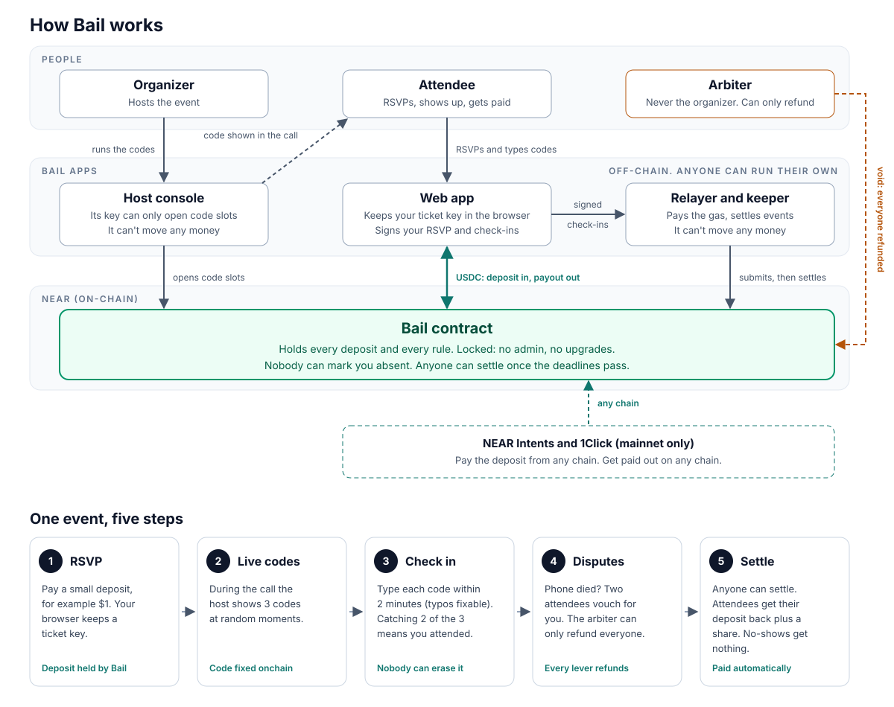
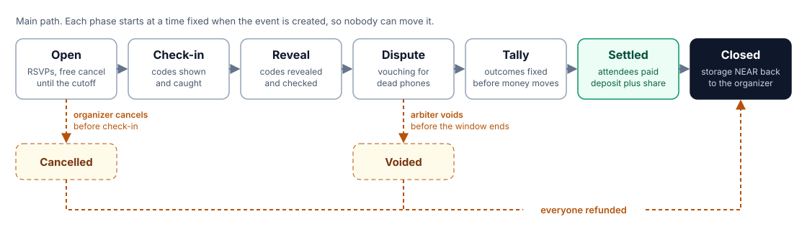
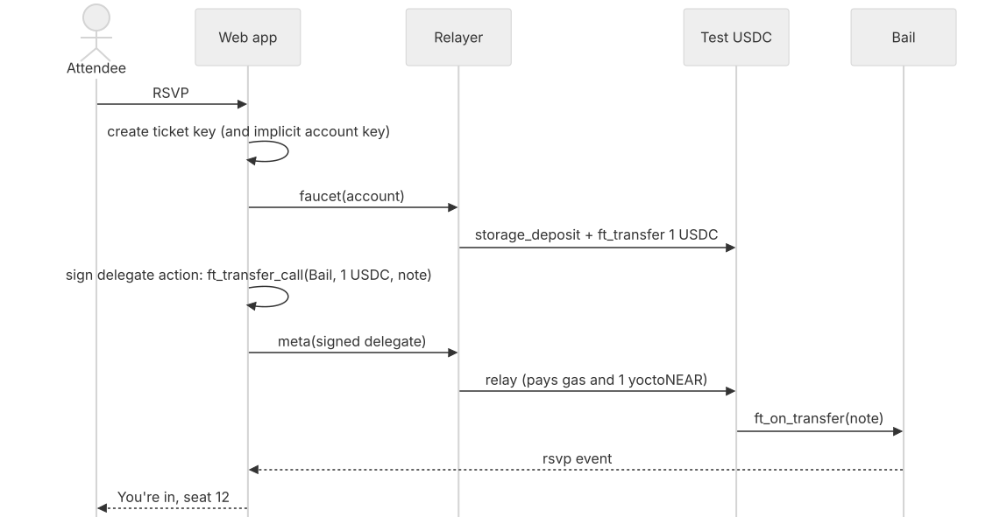
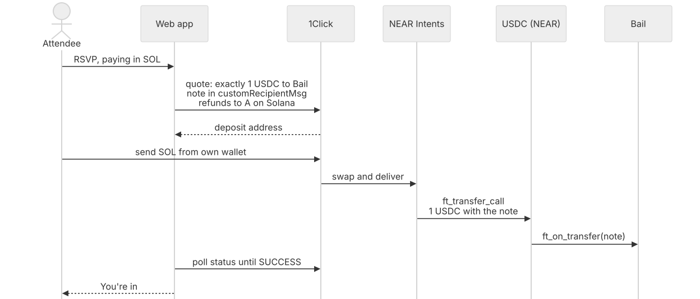
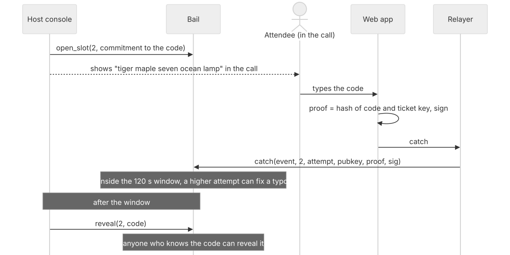
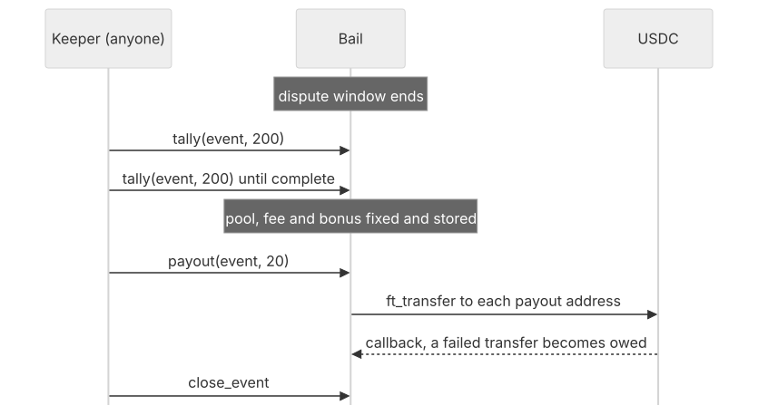

# Bail architecture

> Post bail. Don't bail.

Bail lets people RSVP to an event with a small deposit. Everyone who shows up gets their deposit back plus an equal share of the deposits forfeited by people who didn't. It runs on NEAR. On mainnet the deposit can come from any chain through NEAR Intents.

This is the design for the whole MVP. Event creation and deposit RSVPs are built; the rest is built in the order shown in [ROADMAP.md](ROADMAP.md).

## Contents

1. [The problem and the incumbent](#1-the-problem-and-the-incumbent)
2. [Promises](#2-promises)
3. [System overview](#3-system-overview)
4. [Actors and keys](#4-actors-and-keys)
5. [Event lifecycle](#5-event-lifecycle)
6. [Contract design](#6-contract-design)
7. [Off-chain components](#7-off-chain-components)
8. [Flows](#8-flows)
9. [Threat model](#9-threat-model)
10. [Invariants and how they are tested](#10-invariants-and-how-they-are-tested)
11. [Bail compared with Kickback](#11-bail-compared-with-kickback)
12. [Why NEAR](#12-why-near)
13. [Networks](#13-networks)
14. [Repository layout](#14-repository-layout)
15. [Known limitations](#15-known-limitations)
16. [Beyond the hackathon](#16-beyond-the-hackathon)

## 1. The problem and the incumbent

Free events lose a large share of their RSVPs. Kickback's early organizers reported no-shows falling from around 50% to around 10% once attendees put down a deposit (self-reported, [source](https://medium.com/noblocknoparty/how-blockparty-can-decrease-no-shows-at-your-next-event-5e5895f1a23f)). Businesses already charge for absence: [Offline](https://support.letsgetoffline.com/en/articles/11485358-how-do-event-no-show-fees-work) charges a no-show fee and [Fresha](https://www.fresha.com/help-center/knowledge-base/payments/617-charge-no-show-and-cancellation-fees) lets venues keep deposits.

Kickback is the best-known onchain version, and ETHGlobal used it. Its contract lets the organizer alone decide who attended:

```solidity
// wearekickback/contracts, contracts/AbstractConference.sol, line 266
function finalize(uint256[] calldata _maps) external onlyAdmin onlyActive {
```

The organizer submits an attendance bitmap whenever they like, even before the event starts. Attendees sign nothing and have no way to dispute it. Payouts are the whole balance divided by whoever the organizer marked present. One call can mark only the organizer's own accounts and pay them every deposit.

Bail is built around removing that power.

## 2. Promises

Each promise is an invariant with a test (section 10).

| # | Promise | In plain words |
|---|---|---|
| P1 | Show up, never lose | If you prove you were there, you get back at least what you paid. If a host hides the codes so nobody can prove it, the event's arbiter refunds everyone. |
| P2 | Nobody writes the list | Attendance is proved by attendees, not declared by the organizer. Nothing can erase a valid check-in. |
| P3 | Every lever refunds | Cancelling, voiding, vouching and missing codes can only move money back to the person who paid it. Apart from the published fee, money moves from one person to another only when someone proves presence. |
| P4 | No admin | The contract is locked after deployment. Settlement and payouts are permissionless, so nobody can freeze funds by disappearing. |
| P5 | No cut of your own money | Any fee comes only from forfeited deposits, never from a deposit that is returned. |
| P6 | Plans change | Cancel before the cutoff and get your full deposit back. |
| P7 | Nothing to install | Attendees need no NEAR and pay no NEAR gas. On mainnet they pay from whatever chain they already use, at that chain's normal transfer fee. |

## 3. System overview



The top half shows the pieces. People use Bail apps, and the apps talk to one locked contract on NEAR that holds all the money and all the rules. Money only moves along the green line: a deposit goes in when you RSVP, and your payout comes out at the end. The dashed orange line is the arbiter's only power, which is to refund everyone.

The bottom half shows one event:

1. **RSVP.** Pay a small deposit. The web app creates a ticket key in your browser.
2. **Live codes.** During the call the host shows three codes at random moments. Each code is fixed onchain as its window opens, so it can't be swapped afterwards.
3. **Check in.** Type each code within two minutes; a typo can be corrected inside the window. Catching two of the three means you attended, and nobody else can erase that.
4. **Disputes.** If your phone died, two attendees can vouch for you. Every event names an arbiter, who can only refund everyone.
5. **Settle.** Anyone can settle once the deadlines pass. Attendees get their deposit back plus a share of the no-shows' deposits; no-shows get nothing.

The contract holds all funds and all rules. Every off-chain part is replaceable: the relayer can be swapped for any other account, the host console for any client that can call `open_slot`, and the web app for anything that speaks the SDK.

## 4. Actors and keys

| Actor | Holds | Can | Cannot |
|---|---|---|---|
| Attendee | A ticket key (ed25519) generated in the browser for this event | RSVP, cancel before the cutoff, catch codes, flag a slot where no code was shown, vouch for others | Change where their money is paid once the RSVP is made |
| Organizer | Their NEAR account | Create an event, cancel it before check-in opens, open code slots | Mark anyone present or absent, end the event early, receive forfeits |
| Host console | A function-call key on the organizer's account, limited to `open_slot` on the Bail contract | Open slots | Move NEAR, move tokens, call any other method |
| Relayer | A function-call key limited to Bail's attendee methods and keeper methods | Submit actions attendees signed; run tally and payouts | Forge a signature, choose payouts, move funds |
| Arbiter | An account named at creation that can't be the organizer, such as a Sputnik DAO | Void the event during the dispute window, which refunds everyone | Send money anywhere except back to depositors |
| Anyone | Nothing | Reveal a code they know, tally, pay out | Anything that needs a signature |

Function-call keys are a NEAR protocol feature: the network itself refuses any transaction from that key except calls to the named contract and methods, with no tokens attached. A leaked host or relayer key cannot steal anything. The sandbox test `the_host_key_can_only_open_slots` shows this on a real NEAR node: the network refuses the host key's calls to `cancel_event` and `tally` and its attempt to send NEAR. The protocol checks a key's allowance against the most its attached gas could cost, which for 300 Tgas came to just over 1 NEAR in the sandbox, so the host console attaches 30 Tgas to each `open_slot` call.

## 5. Event lifecycle



The main path runs left to right. The two side exits, an organizer cancelling before check-in and an arbiter voiding during the dispute window, both end with everyone refunded. What happens inside each phase is in the table below.

Phase boundaries are timestamps fixed at creation and never editable. The contract derives the phase from the block time, so no transaction is needed to move between phases.

| Phase | Starts | Who acts | What happens |
|---|---|---|---|
| Open | `create_event` | Attendees | Deposits become seats. Cancelling before `cancel_cutoff_ms` refunds in full. |
| CheckIn | `checkin_opens_at_ms` | Host, attendees | The host opens up to K code slots, one at a time, at moments of their choosing. Attendees catch each code within its window and can flag a slot where no code was shown. |
| Reveal | `checkin_closes_at_ms` | Anyone who knows a code | Each code can be revealed as soon as its own window closes, up to the reveal deadline, and is checked against its commitment. Unrevealed slots become void at the deadline. |
| Dispute | `reveal_deadline_ms` | Qualified attendees, arbiter | Vouching for people whose phone died. The arbiter may void the event. |
| Tally | `dispute_ends_at_ms` | Anyone | Tickets are classified in pages, the split is fixed, then reliability is recorded in pages. |
| Settled | tally complete | Anyone | Payouts are pushed in pages. Each ticket can also be claimed individually. |
| Closed | everything paid | Anyone, in pages | Ticket storage is freed and unused prepaid NEAR goes back to the organizer. |

Minimum durations (`min_dispute_ms` and similar) and a maximum total event length are set once at contract init. The minimums are short on testnet so judges can watch a whole cycle, and longer on mainnet. The maximum stops an organizer from locking deposits for months.

## 6. Contract design

Rust, near-sdk 5.30. One contract, no upgrade path, locked after deployment.

### 6.1 State

```rust
pub struct Bail {
    config: Config,                                   // fee_bps, fee_account, duration limits, intents account; fixed at init
    next_event_id: EventId,
    events: LookupMap<EventId, Event>,
    tickets: LookupMap<(EventId, TicketKey), Ticket>,
    ticket_index: LookupMap<(EventId, u32), TicketKey>, // position -> ticket, so tally can page through
    owed: LookupMap<(EventId, String), u128>,         // refunds and excess by payout address; at most one per seat, prepaid
    reputation: LookupMap<String, Record>,            // shows and RSVPs per payout address
}

pub struct Event {
    organizer, arbiter, token, deposit, capacity, registered, tickets_created,
    owed_records, owed_total, closed,
    schedule: Schedule,        // all timestamps, fixed at creation
    checkin: CheckinConfig,    // slots K, required catches R, window length
    slots: Vec<Slot>,          // opened_at, commitment, revealed, no-code flags
    status: Status,            // Active, Cancelled or Voided
    tally: Option<Tally>,      // stage, cursor, counts, pool, fee, bonus, dust; fixed before money moves
}

pub struct Ticket {
    payout_to: String,         // fixed at RSVP
    index: u32,                // position in the event's ticket index
    catches: [Option<Catch>; MAX_SLOTS], // proof and attempt number, per slot
    vouched_for: Option<PublicKey>, // the one ticket this attendee vouched for
    vouched_by: u8,
    outcome: Option<Outcome>,  // Attended, Vouched, Forfeited, Refunded
    paid: bool,
}
```

### 6.2 Methods

| Method | Caller | Phase | Effect |
|---|---|---|---|
| `new(config)` | the contract account itself (`#[private]`), in the deploy transaction | once | Fixes the fee and the duration limits. |
| `create_event(event)` | organizer, with storage NEAR | any | Validates the schedule against the duration limits, requires an arbiter other than the organizer, and checks that prepaid storage covers every seat. |
| `ft_on_transfer` | token contract | Open | Turns a deposit into a seat, or records it as owed (6.3). |
| `cancel_rsvp(event, ticket, sig)` | anyone, ticket-signed | Open, before cutoff | Frees the seat. The full deposit is owed to the ticket's payout address. The freed ticket record pays for that refund record, so the owed cap doesn't apply. |
| `cancel_event(event)` | organizer, with 1 yoctoNEAR so only a full-access key can do it | before check-in | Status becomes Cancelled. Deposits arriving afterwards are owed, and every ticket is refunded in the payout pages. |
| `open_slot(event, slot, commitment)` | organizer account (host key) | CheckIn | Starts a code window and stores the code's commitment. Each slot opens once, only after the previous slot's window has closed, and only if its own window ends before check-in closes. |
| `catch(event, slot, attempt, ticket, proof, sig)` | anyone, ticket-signed | slot window | Stores the proof. A ticket can resubmit inside the window to fix a typo; each attempt number must be higher than the last, so an old signature can't be replayed. |
| `flag_slot(event, slot, ticket, sig)` | anyone, ticket-signed | slot window to reveal deadline | Records that this ticket saw no code for the slot. Evidence for the arbiter; it moves no money. |
| `reveal(event, slot, code)` | anyone | Reveal | Checks the code against the slot's commitment and marks the slot revealed. |
| `vouch(event, voucher, target, sig)` | anyone, voucher-signed | Dispute, from the reveal deadline | An attendee with final, verified attendance vouches once, never for themselves or for someone who already attended. Two vouches make the target Vouched. |
| `void_event(event)` | arbiter, with 1 yoctoNEAR, which a Sputnik DAO proposal can attach | before `dispute_ends_at` | Status becomes Voided. Deposits arriving afterwards are owed, and every ticket is refunded in the payout pages. |
| `tally(event, limit)` | anyone | after the dispute window, or at once if cancelled or voided | Classifies up to `limit` tickets per call. Once all are classified it fixes the pool, fee, bonus and dust, then records reliability in further pages. |
| `payout(event, limit)` | anyone | tally done | Starts up to `limit` payouts. Each ticket is marked paid first, so nothing is paid twice. |
| `claim(event, ticket)` | anyone | Settled | Pays one ticket. |
| `claim_owed(event, payout_to)` | anyone | any | Pays an owed amount. The record is removed first and restored if the transfer fails. |
| `on_transfer(...)` | the contract itself (`#[private]`) | after each transfer | Reads the token's answer: a failed ticket payout is rolled back so it can be paid again, a failed owed claim is restored, and anything NEAR Intents returns is owed. |
| `close_event(event, limit)` | anyone | all paid | Frees ticket storage in pages, then returns unused storage NEAR to the organizer. |
| Views | anyone | any | `get_config`, `get_event`, `get_ticket`, `get_tickets(event, from, limit)`, `standing`, `event_totals`, `get_payout`, `get_owed`, `reliability`, `storage_cost`. |

### 6.3 Deposits

A deposit is an `ft_transfer_call` of the event's token to the contract, with this note as `msg`:

```json
{ "event_id": 7, "ticket_key": "ed25519:<base58>", "payout_to": "near:alice.testnet" }
```

1Click delivers exactly this through `customRecipientMsg`, so a deposit from Solana and a deposit from a NEAR wallet take the same code path.

The rule is to bounce only what cannot be returned any other way. When a delivery comes through 1Click, a bounce goes to whichever account made the delivery, not to the attendee.

| Situation | Result |
|---|---|
| Note unreadable, unknown event, wrong token, bad ticket key, or a payout address Bail can't pay (anything but `near:<account>`, or `intents:<account>` where enabled) | Bounced to the sender |
| Less than the deposit | Bounced, because it can't pay for a refund record's storage |
| RSVP closed, event full, cancelled or voided, ticket already registered | Recorded as owed to the payout address |
| The event has already taken two RSVPs per seat over its lifetime, cancellations included | Recorded as owed (`rsvp_limit`), so cancel-and-rejoin loops are bounded |
| More than the deposit | Seat, with the excess owed |
| The event's owed records already equal its capacity | Bounced, so refused transfers can never use more storage than the organizer prepaid |

An underpaid delivery through 1Click bounces to the account that delivered it. Exact-output quotes make underpayment unlikely, and section 15 lists it as a known limitation.

### 6.4 Check-in with live codes

Proving presence at an online event without trusting the host is the hard problem. Bail's answer has five parts.

1. **Codes.** For each slot the host console generates a code of five words from the 2,048-word BIP-39 list, about 55 bits of randomness. Five words are easy to read aloud on a call, and the web app autocompletes them from the same list.
2. **Commitment.** When the host opens slot `i`, the console posts `commitment_i` (6.10) and shows the code in the session. The window lasts `window_ms` (default 120 seconds, minimum 60) from the block that opened it. A slot can only open after the previous slot's window has closed, so three codes really are three separate moments, and every window must end before check-in closes.
3. **Proof.** An attendee who hears the code submits a proof that hashes the code together with their own ticket key, signed by that key. The proof only works for that key, so nobody can copy it. An attendee who mistypes can resubmit inside the window. Each attempt carries a higher attempt number, so nobody can replay an older, wrong attempt over a newer one.
4. **Reveal.** After the window closes, anyone who caught the code can reveal it: the host or any attendee. The contract checks it against the commitment, and every stored proof can then be checked. Reveals are rejected until the window has closed, so a revealed code never helps a latecomer. A host who goes silent can't stop attendees from revealing the codes they caught.
5. **Flags.** From the moment a slot opens until the reveal deadline, an attendee can flag that no code was shown. Flags move no money. They are public evidence for the arbiter (6.6).

There is deliberately no secret salt in the commitment. While a window is open, the commitment and everyone's proofs are public, so someone could try to recover the code by hashing guesses. With 55 bits that is 2^55 hashes. At about 22 billion SHA-256 hashes per second, a high-end GPU's rate, that is roughly 19 days of work, or about 14,000 GPUs to finish inside a two-minute window: far beyond what a deposit is worth. Every hash is tied to one contract, event and slot, so nothing can be computed in advance. A salt would add nothing here, and because attendees never see it, it would stop them from revealing the codes they caught.

### 6.5 Qualification

With `K` slots declared and `R` catches required, a slot is void if it was never opened, or was opened but not revealed by the reveal deadline. With `v` void slots:

```
attended(t)  <=>  verified_catches(t) >= max(0, R - v)
```

A void slot costs a ticket at most the one catch it held in that slot, and lowers the bar by one, so voiding can only turn people into attendees, never the reverse (P3). If the host never runs check-in, `v >= R` and everyone qualifies, which means everyone gets their deposit back.

A slot that never opened becomes void when check-in closes, and one that opened but was never revealed becomes void at the reveal deadline. Until then it is pending, and the `standing` view reports `is_final: false`. A test checks every combination of slot outcomes, for every number of slots and every required count, and confirms that voiding any slot never disqualifies anyone.

### 6.6 Recourse

| Lever | Who | When | Result | Why it can't be abused |
|---|---|---|---|---|
| `cancel_rsvp` | the attendee's ticket | before the cutoff | Full refund, seat freed | Money goes to the payout address fixed at RSVP, so a stolen ticket can't redirect it. |
| `cancel_event` | organizer | before check-in opens | Everyone refunded | Refund only. |
| `vouch` | two qualified attendees | dispute window | The target gets their deposit back, with no bonus | One vouch per voucher. A vouched ticket only recovers its own money, so collusion can at most shrink the bonus pool. |
| `void_event` | the arbiter named at creation | until `dispute_ends_at` | Everyone refunded | Refund only. An arbiter can grief but never steal. |

Every event names an arbiter at creation, and it can't be the organizer. The arbiter covers the one attack the code mechanism can't prevent: a host who never shows the codes to the public and gives them only to their own tickets. A stolen host key allows the same attack. Everyone in the call sees that no code appeared and can flag the slot onchain. The arbiter (for example the community's Sputnik DAO, through a FunctionCall proposal) voids the event and everyone is refunded. The arbiter is shown on the event page before anyone deposits. The contract can check that it isn't the organizer's own account, but only attendees can judge whether it is truly independent.

### 6.7 Settlement

For an event with deposit `D`:

```
A = attended tickets      V = vouched tickets      F = forfeited tickets
pool   = F * D
fee    = pool * fee_bps / 10_000
bonus  = (pool - fee) / A                (integer division)
dust   = (pool - fee) - bonus * A        (less than A micro-units)
fee + dust are owed to the fee account, which anyone can pay out with claim_owed;
with no fee account the dust stays in the contract

attended  receives  D + bonus
vouched   receives  D
forfeited receives  0
if A == 0, the event is treated as voided and everyone receives D
```

Worked example, 20 RSVPs at 1 USDC (6 decimals), no fee: 15 attend, 1 is vouched, 4 don't come.

| | Count | Each | Total (micro-USDC) |
|---|---|---|---|
| Attended | 15 | 1.266666 | 18,999,990 |
| Vouched | 1 | 1.000000 | 1,000,000 |
| Forfeited | 4 | 0 | 0 |
| Dust | | | 10 |
| **Sum** | 20 | | **20,000,000** (equals deposits) |

Tally runs in pages of `limit` tickets, so a 1,000-seat event settles in a few transactions. Tally computes everything before any money moves, and the totals are stored on the event, so `event_totals` shows the conservation check at all times. The contract's tests reproduce the worked example above to the micro-USDC, and check that tallying in pages of 3 gives exactly the same result as one call.

Cancelled and voided events can be tallied at once, and every ticket comes out Refunded.

### 6.8 Payouts

Each ticket is marked paid before its transfer starts, so nothing is paid twice. The callback reads the token's answer. If the transfer failed (for example, the recipient isn't registered with the token), the mark is cleared and the ticket can be paid again with `payout` or `claim`; this needs no new storage. If NEAR Intents returns part of a transfer, the returned amount is owed. An answer the contract can't read counts as paid, so a confusing token can never cause a second payment. Closing an event moves any still-unpaid payout into an owed record, so nothing is lost.

Payout addresses:

- `near:<account>`: an `ft_transfer` to a NEAR account. Works on testnet and mainnet.
- `intents:<id>` (accepted only where the contract was initialised with an Intents account, so mainnet only): an `ft_transfer_call` into `intents.near` whose `msg` is the receiving account ID, the plain form NEAR Intents' deposit parser accepts. It credits an Intents account the attendee's own wallet controls, such as their EVM address. It needs no bridge fee, and they can withdraw to any chain whenever they like. If Intents returns part of the transfer, the callback records the returned amount as owed. This path is checked with a tiny mainnet payout before it is used for real.

### 6.9 Reputation

Tally records each ticket's outcome against its payout address: RSVPs, attended, vouched, forfeited. It only does so when attendance was actually measured: not for cancelled or voided events, not when nobody attended, and not when so few codes were revealed that nobody needed a catch. Otherwise a host who skipped check-in would hand everyone a perfect record. `reliability(payout_to)` returns the record, and the web app shows it as a badge. It is a signal, not a guarantee: one person can hold several addresses. Later it powers smaller deposits for reliable people and bonus weighting (section 16).

### 6.10 Signed messages

Ticket signatures cover canonical UTF-8 strings, so the Rust contract and the TypeScript SDK can't disagree about serialization:

```
bail/v1/catch/<contract_id>/<event_id>/<slot>/<attempt>/<proof_hex>
bail/v1/flag/<contract_id>/<event_id>/<slot>
bail/v1/cancel/<contract_id>/<event_id>
bail/v1/vouch/<contract_id>/<event_id>/<target_public_key>
```

The contract id stops a testnet signature from replaying on mainnet, and the event id stops one event's signature from replaying on another. In the vouch message the target key appears as `ed25519:<base58>`, rebuilt by the contract from the key's bytes so the signed text doesn't depend on how a caller formatted it. Cancel, flag and vouch are one-shot per ticket. Catches carry an attempt number that must increase, which is the only nonce needed. Signatures are passed as base64-encoded 64-byte ed25519 signatures, and the contract checks them with NEAR's `ed25519_verify` host function. Commitments and proofs are passed as base64-encoded 32 bytes; inside a signed message the proof appears as lowercase hex.

Hashes: `commitment = sha256(F("bail/v1/code") ‖ F(contract_id) ‖ F(event_id) ‖ F(slot) ‖ F(code))` and `proof = sha256(F("bail/v1/proof") ‖ F(contract_id) ‖ F(event_id) ‖ F(slot) ‖ F(code) ‖ F(pubkey))`. `F(x)` is the length of `x` as 4 little-endian bytes followed by `x`, so no two different inputs produce the same bytes. `event_id` is 8 little-endian bytes, `slot` is 1 byte and `pubkey` is the 32 raw key bytes. Codes are normalized to lowercase ASCII words joined by single spaces, at most 64 bytes. The contract's tests pin both hashes against test vectors computed independently in Python. The SDK's agreement with the contract is checked through `packages/sdk/test/vectors.json`, which the contract's own code builds (I8 in section 10).

### 6.11 Storage and gas

| Item | Who pays | Notes |
|---|---|---|
| Event and seats | organizer, at creation | A per-seat amount covers the ticket, its catches, its index entry, a reliability record and owed records. A test builds the worst case: every seat filled, cancelled and refilled, a refused deposit per seat, every code caught, flagged and revealed at full length, with the longest addresses Bail accepts, and checks actual storage against what was prepaid. At close the organizer gets everything back except the event's own budget and upper bounds for the owed and reliability records that outlive it, so the refund can never exceed what is truly unused. |
| Owed records | organizer, as part of each seat | Refused transfers create at most one per seat. Cancellation refunds create at most one per RSVP, and an event takes at most two RSVPs per seat over its lifetime. Past the cap, refused transfers bounce, so a flood of transfers can never drain the contract's storage and freeze other events. |
| Gas for attendees | relayer | Bounded by the relayer key's allowance. |
| Tally, payout and close | whoever calls them, usually the keeper | Paged, so each call stays under the 300 Tgas limit. |

At NEAR's storage price (1 NEAR per 100 KB), a 30-seat event prepays about 0.3 NEAR, most of which comes back.

### 6.12 Fees

`fee_bps` is set once at init and capped at 10%. It applies only to forfeited deposits (P5). On testnet it is 0. The revenue model for mainnet is a small share of forfeits, which also pays for relayer gas.

## 7. Off-chain components

### 7.1 SDK (`packages/sdk`, TypeScript)

- Ticket keys: generate, back up in NEAR's secret key format, restore (ed25519 via `@noble/curves`).
- Signed `catch`, `flag`, `cancel` and `vouch` actions whose arguments are exactly the contract method's, so a relayer only forwards them.
- RSVP notes, five-word codes from the BIP-39 list, commitments and proofs, byte-identical to the contract.
- Typed views over NEAR RPC, the lifecycle phase at any time, and a relayer client.

### 7.2 Relayer and keeper (`apps/relayer`, Node)

- `POST /v1/catch`, `/v1/flag`, `/v1/cancel`, `/v1/vouch` take exactly the contract method's arguments. The relayer checks the fields, the ticket's signature (rebuilt with the SDK, as the contract will) and that the ticket exists, rate-limits per IP and per ticket, then submits with a function-call key limited to Bail's attendee and keeper methods, none of which takes attached NEAR. After a cancellation it claims the refund. Keys come from environment variables and are never logged.
- Keys form a pool. Each sends one transaction at a time and is held only until that transaction is included, so no key reuses or skips a nonce; results are read afterwards.
- Keeper loop: judging deadlines by block time, as the contract does, it calls `tally`, `payout` and `close_event` in pages, halving any page that runs out of gas, and waits six hours after the last payout before closing: closing frees each ticket's storage, and with it the per-ticket results attendees look up, while only refunding the organizer's storage.
- Testnet only, from a separate sponsor account holding a little test NEAR and test USDC: `POST /v1/faucet` turns the attendee's ticket key into an implicit account (its address is the key in hex), registers it with the test USDC contract and sends exactly the event's deposit, once per account and event. `POST /v1/meta` sponsors a NEP-366 signed delegate action only if it is exactly `ft_transfer_call(bail, D, note)` on the event's token: from the implicit account of the key that signed it, with 1 yoctoNEAR and at most 100 Tgas, the event's exact deposit, no other arguments, unexpired, canonically encoded, and a note for this event naming a payable address. The SDK encodes delegate actions itself, held byte for byte to near-api-js by its tests, so the browser doesn't need near-api-js.
- Anyone can run a relayer, and attendees can also call the contract directly. A relayer can delay an action but cannot forge or change one.

### 7.3 Host console (`apps/host`, CLI)

`create` (event plus storage deposit, and one five-word code per slot, kept on the host's machine), `grant-key` (a function-call key limited to `open_slot` and `reveal`, so the screen-shared terminal holds nothing that can move money), `live` (opens each slot at a random moment timed from the chain's record of the previous slot, shows the code large for screen share or reading aloud with a countdown, and reveals it when its window closes), `reveal`, `status`, `report` (attendance and payouts in Markdown, for the README), and `bots` (SDK-driven rehearsal attendees that RSVP through the faucet and catch codes through the relayer). `apps/host/test/sandbox.test.ts` runs a whole event this way on a local NEAR node.

### 7.4 Web app (`apps/web`)

A static site (Vite, React, TypeScript, plain CSS, and the browser-safe SDK). It reads the chain over public RPC with failover and writes through the relayer, and is configured by a `config.json` beside it, so one build serves any deployment. It is built phone first, because attendees type codes on a phone while watching the call.

- **Event page:** what the event is, when check-in opens in the viewer's timezone, seats, deposit, how it works in plain words, the named arbiter, the fixed schedule and public evidence. It needs no ticket. Titles and call links come only from `config.json`, because the contract stores none.
- **RSVP:** terms and a payout address, then a full-screen key backup, then payment. The ticket key is made in the browser, shown only on request, and never sent anywhere. Every step reads the chain first, so a retry after a failure or lost reply cannot pay twice or make a second ticket. A deposit that reaches Bail without a seat is reported as owed, not as refunded.
- **Live check-in:** when a code opens, it takes over the screen with a countdown and one input for the five words, word-list suggestions that never take focus from the input, "sent" distinguished from "confirmed after the host reveals the code" (decided by the contract's own proof check), corrections with rising attempt numbers, and a "the host did not show a code" flag that is labelled as evidence for the arbiter.
- **Dispute and results:** the viewer's standing, vouching, then outcome, payout and whether it was actually paid. Results are kept in the browser, because closing an event frees the onchain ticket record.
- **Organizer view:** public and read only: headcount and per-code activity, labelled with when it was read.
- **Other chain:** a marked placeholder, "Planned for mainnet". Nothing there works yet.

The ticket key lives in the browser's local storage per event, falling back to memory (with a warning) if storage is blocked. The end-to-end test, `apps/web/e2e/run.ts`, builds the site and drives it in headless Chrome at phone size against a private NEAR node running the compiled contract, the relayer and the keeper, through a whole event. Setup and commands are in [apps/web/README.md](../apps/web/README.md).

## 8. Flows

Every diagram in this document is an SVG image, so it shows in any markdown viewer. The four flows below are rendered from Mermaid sources in [diagrams/](diagrams/) by `scripts/render-diagrams.sh`; the overview and lifecycle pictures are drawn by hand.

### 8.1 RSVP on testnet



### 8.2 RSVP on mainnet from another chain



If the swap fails, 1Click refunds the attendee's own Solana address automatically.

### 8.3 Live check-in



### 8.4 Settlement



## 9. Threat model

| Threat | Who | What Bail does | What remains |
|---|---|---|---|
| Organizer marks real attendees absent | organizer | There is no such function. Only a ticket's own signature can change its catches. | None |
| Organizer ends the event early | organizer | Phases are timestamps fixed at creation. Tally only after the dispute window. | None |
| Organizer hides codes and gives them only to their own tickets | organizer | Every event has an arbiter who isn't the organizer. Attendees flag the slots onchain, and the arbiter voids the event so everyone is refunded. | Relies on the arbiter being independent, which the contract can't prove (section 15). |
| Organizer opens all slots at once | organizer | A slot can open only after the previous window has closed. | None |
| Organizer locks deposits for months | organizer | A maximum total event length, fixed at contract init. | None |
| An app's login key cancels an event | anyone holding such a key | `cancel_event` needs 1 yoctoNEAR attached, which only a full-access key can do. | None |
| Sock-puppet tickets that genuinely catch codes | anyone | Each costs a full deposit, and they can only share the pool funded by real no-shows. An honest attendee's deposit is never at risk. | They dilute the bonus. Reputation weighting is the long-term answer (section 16). |
| Faucet drained (testnet) | anyone | One deposit per account and event, five requests per IP an hour, deposits up to 5 USDC, and only for events taking RSVPs. The sponsor is its own account, kept small, so the relayer's keys and the contract are never at stake. | Someone with many IPs can drain test tokens; refilling costs nothing. |
| Seat squatting | anyone | Each seat locks a full deposit until the event ends. | Someone with enough capital can fill an event. Organizer approval and reputation are the long-term answer. |
| Relaying the code to an absent friend | attendees | Short windows, separate moments, a 2-of-3 requirement and small deposits make it not worth the effort. | Can't be fully prevented online. In-person door mode (section 16) is stronger. |
| Copying someone's proof | anyone | Proofs are bound to the ticket key. | None |
| Replaying an old, wrong catch over a corrected one | anyone | Attempt numbers must increase. | None |
| A typo in a code | attendee | Resubmission inside the window, and word-list autocomplete. | A typo noticed after the window closes can't be fixed. |
| Brute-forcing a code during its window | anyone | 55-bit codes, separate two-minute windows, hashes tied to one contract, event and slot. | Negligible at these stakes. |
| Early reveal helping latecomers | anyone | Reveals are rejected until the window has closed. | None |
| Host goes silent after the event | host | Anyone who caught a code can reveal it. Unrevealed slots only lower the bar. | None |
| Host key stolen | attacker | The key can only call `open_slot`, with no tokens attached, so it can't move funds. | The thief can act like a dishonest host. Same defence: flags and the arbiter. |
| Relayer key stolen | attacker | The key can only call Bail methods that need a ticket signature or are permissionless anyway. | None |
| Relayer censors an attendee | relayer | Anyone can submit a signed action: other relayers or the attendee directly. | Delay during a short window. |
| Ticket key stolen | attacker | The payout address is fixed at RSVP, so the thief can only catch codes for someone else's benefit, or cancel and refund the owner. | The owner loses their seat if the thief cancels. |
| Ticket key lost | attendee | Two attendees can vouch, using the target's public key, which is onchain. | Vouched tickets get their deposit back with no bonus. |
| Arbiter abuse | arbiter | `void_event` only refunds. | Griefing: everyone gets refunds and no bonus. |
| Payout transfer fails | token | Marked paid first and rolled back on failure, so it can be paid again; at close it moves to an owed record. | None |
| A token gives an answer the contract can't read | token | It counts as paid. | A confusing token can't cause a second payment; at worst that one payout needs manual follow-up. |
| Storage flood from many tiny transfers, or cancel-and-rejoin loops | anyone | Owed records are prepaid and capped; an event takes at most two RSVPs per seat over its lifetime. | None |
| Deposit arrives after a cancellation | anyone | Deposits into a cancelled or voided event are recorded as owed, never seated. | None |
| Underpaid 1Click delivery | infrastructure | Exact-output quotes. | It bounces to the delivering account, not the attendee. |
| 1Click delivery problems | infrastructure | Tested with a $1 delivery before any mainnet use. Only notes that name a payout address are ever kept. | `customRecipientMsg` is marked "HIGHLY EXPERIMENTAL" by NEAR Intents. |
| Token issuer powers | Circle | Inherited: USDC can be paused or blocklisted by its issuer. | Disclosed. |
| Contract bug | developer | Invariant tests, small deposits, testnet first. | Unaudited, and a locked contract can't be patched in place (section 15). |
| Block timestamp skew | validators | Windows are at least 60 seconds. | Seconds of skew. |

## 10. Invariants and how they are tested

| Id | Invariant | Tests |
|---|---|---|
| I1 | Conservation: every token an event takes in goes back out, as payouts, owed refunds or the fee, except dust held when there is no fee account. | `every_history_keeps_bails_promises` pays out random event histories (256 per `cargo test`, 1,000 in continuous integration, any number with `PROPTEST_CASES`) and checks the totals to the micro-unit. `tally_reproduces_the_worked_example` checks section 6.7. `a_whole_event_runs_on_the_compiled_contract` checks the same on a NEAR node: every account's balance to the unit, and the contract left holding none of the event's tokens. |
| I2 | Principal protection: an attended, vouched or refunded ticket receives at least D. | `every_history_keeps_bails_promises`. |
| I3 | No erasure: only a ticket's own signature can change its catches, and only inside the slot's window. Nothing turns an attended ticket into anything else. | `every_history_keeps_bails_promises` checks every ticket's outcome against an independent model built from what it actually heard. Unit tests cover overwrites, replays and signatures. |
| I4 | Time lock: no tally before `dispute_ends_at`, and no schedule edits ever. | Unit tests for scheduling and tally, including `bail_has_no_early_finalize`. |
| I5 | Refund bias: cancel, void, vouch and void slots never reduce what any depositor receives below D, and never pay anyone more than D unless they attended. | `every_history_keeps_bails_promises` (cancelled and voided events refund exactly D, vouched tickets get exactly D) and `voiding_a_slot_never_disqualifies_anyone`. |
| I6 | Liveness: after the deadlines, tally and payout succeed when called by any account. | `a_whole_event_runs_on_the_compiled_contract` runs a six-person event on the compiled wasm in a local NEAR sandbox. An account with no role in the event submits the attendees' signed catches and vouches, then runs tally, payout, the owed claims and close. Every payout lands, including one refused by an unregistered wallet and claimed once it registers, and the organizer's unused storage comes back. `apps/relayer/test/sandbox.test.ts` runs an event through the real relayer and keeper on a local NEAR node: the keeper tallies, pays out and closes with no one else calling anything. |
| I7 | Bounded bounce: a transfer is bounced only when it names no payable address or underpays. | Unit tests for deposits. |
| I8 | Agreement: the SDK builds the same hashes, signed messages, signatures and RSVP notes as the contract, and refuses exactly the payout addresses it refuses. | `sdk_vectors_match_the_contract` builds `packages/sdk/test/vectors.json` from the contract's own functions, depositing every RSVP note into a contract to record whether it is accepted, and fails if the committed file differs. `vectors.test.ts` checks the SDK against the same file. Changing one number in the file fails both. |
| A1 | Access: the host key can only open slots, and only the contract itself can initialise the contract or answer a transfer. | `the_host_key_can_only_open_slots`, `only_the_contract_can_initialise_itself` and `only_the_contract_can_answer_a_transfer`, all on the compiled wasm, since NEAR enforces key permissions and `#[private]` only on a real node. |
| Q1 | Voiding a slot never disqualifies anyone. | `voiding_a_slot_never_disqualifies_anyone`: every combination of slot outcomes for every K and R. |
| K1 | The Kickback attack (organizer marks only their own accounts) succeeds against Kickback's own Solidity contract and fails against Bail. | `tests/kickback`: Foundry runs Kickback's MIT-licensed source, copied in unchanged with SHA-256 hashes, and the organizer takes all four deposits. `the_kickback_attack_fails_against_bail` and `hiding_the_codes_is_undone_by_the_arbiter` run the same scenario on Bail. |
| R1 | The residual risk is real: without the arbiter, hidden codes cost honest attendees. | `if_the_arbiter_does_nothing_hidden_codes_cost_honest_attendees`, so the threat model's admission is shown, not just stated. |

The property test was itself checked by planting bugs: giving vouched tickets a bonus, and making qualification one catch stricter. It caught both and shrank each to a minimal failing history; those histories are kept in `contracts/bail/proptest-regressions` and replayed on every run.

Continuous integration (`.github/workflows/ci.yml`) runs on every push: formatting, lints with warnings as errors, the unit and property tests with 1,000 cases, the sandbox tests, the wasm build, the Kickback test after checking the copied source against its SHA-256 hashes, and the SDK's, relayer's, host console's and web app's type checks and tests, including the relayer, keeper, host console and web app running events on a local NEAR node, the last of them driven in headless Chrome at phone size.

The contract's `Cargo.toml` pins its reproducible build to a Docker image by digest. Two builds of the same commit give byte-identical wasm, so anyone can rebuild the deployed contract from this repository and compare its hash with the code onchain.

[CLAIMS.md](../CLAIMS.md) maps every claim in the README to its source line or its test.

## 11. Bail compared with Kickback

| | Kickback | Bail |
|---|---|---|
| Who records attendance | The organizer, alone, as a bitmap | Each attendee, by signing codes shown in the session |
| Can attendance be removed | Yes, by submitting a different bitmap | No |
| Can the event be ended early | Yes, `finalize` has no time check | No, phases are fixed timestamps |
| Disputes | None | Vouching, and an arbiter who can only refund |
| Lost phone | Deposit lost | Vouched by two attendees |
| Change of plans | Not supported | Full refund before the cutoff |
| Who settles | The organizer | Anyone |
| Deposits | ETH or a token on one chain, attendee pays gas | Any asset on any chain (mainnet), no NEAR gas |
| Admin keys | Yes | None, the contract is locked |

## 12. Why NEAR

| NEAR feature | What it does for Bail |
|---|---|
| Function-call access keys | The host console and the relayer hold keys the protocol itself limits to specific methods, so a leak can't steal anything. |
| Meta transactions (NEP-366) | Testnet attendees pay their deposit from an account with no NEAR. |
| NEAR Intents and 1Click | Mainnet deposits from any chain and asset, delivered with the RSVP note. Payouts into Intents balances that withdraw anywhere. |
| `ed25519_verify` host function | The contract checks ticket signatures itself, so attendees need no NEAR account at all. |
| Named accounts and sub-accounts | The contract lives at `v1.dontbail.testnet`. Each version is a locked sub-account, so a fix ships as `v2` without anyone holding an upgrade key. |
| Sputnik DAO | A community DAO can be an event's arbiter with no extra code: a FunctionCall proposal to `void_event`. |
| Cheap storage | A 30-seat event prepays about 0.3 NEAR of storage (around $1.30 today), most of it returned when the event closes. |

## 13. Networks

| | Testnet (MVP) | Mainnet |
|---|---|---|
| Contract | `v1.dontbail.testnet`, locked. A bug fix means deploying `v2`; the parent account stays with the owner. | `v1.dontbail.near`, locked |
| Token | Circle test USDC `3e2210e1184b45b64c8a434c0a7e7b23cc04ea7eb7a6c3c32520d03d4afcb8af` | Native USDC `17208628f84f5d6ad33f0da3bbbeb27ffcb398eac501a31bd6ad2011e36133a1` |
| Deposits | Faucet plus meta transaction from a browser-generated account | 1Click from any chain, or a NEAR wallet directly |
| Payouts | `near:` accounts | `near:` accounts and `intents:` balances |
| 1Click | Dry quotes only (NEAR Intents has no testnet) | Live |
| Durations | Short minimums for demos | Hours |

`scripts/deploy.sh` builds the contract reproducibly, deploys and initialises it in one transaction on a fresh sub-account, registers it with test USDC, checks the onchain code hash, and only then deletes the account's one key. Bail has no method that deploys code or adds keys, so after that nobody, including its author, can change it. A token other than test USDC needs the contract registered with it first, which anyone can do with `storage_deposit`.

`scripts/verify.py` checks a deployment using only the chain and this repository. It confirms the account has no keys, reads the source commit and build image the contract names (NEP-330), rebuilds that commit in that image, and compares the hash with the code onchain.

The testnet contract was deployed this way on 4 November 2026. [deployments/testnet.json](../deployments/testnet.json) records its source commit, code hash, config and the four transactions that created, deployed, registered and locked it.

The hackathon rules allow testnet-only projects in every track (Q-010) and ask for mainnet with tiny amounts only where an integration is mainnet-only (Q-007).

## 14. Repository layout

```
bail/
  contracts/bail/          the contract (Rust, near-sdk 5.30)
    src/                   lib.rs, event.rs, deposit.rs, tickets.rs, cancel.rs, checkin.rs, reveal.rs,
                           recourse.rs, settle.rs, payout.rs
    src/tests.rs           unit tests; src/tests/proptests.rs, the random-history property test;
                           src/tests/vectors.rs, which builds the SDK's test vectors
    tests/sandbox.rs       sandbox integration tests on the compiled wasm
  contracts/test-token/    a standard NEP-141 token for the sandbox tests
  tests/kickback/          Foundry project: Kickback's own contract (MIT, unchanged) and the attack test
  packages/sdk/            TypeScript SDK and shared test vectors
  apps/relayer/            relayer, keeper and testnet faucet
  apps/host/               host console
  packages/testkit/        a local NEAR node with Bail and a test token, for integration tests
  apps/web/                web app
  scripts/                 deploy.sh, verify.py, render-diagrams.sh
  deployments/             testnet.json: the deployed contract, its source commit and transactions
  docs/                    ARCHITECTURE.md, ROADMAP.md
    diagrams/              Mermaid sources for the four flow diagrams
    images/                rendered SVG diagrams
  .github/workflows/       continuous integration
  README.md  CLAIMS.md  LICENSE
```

## 15. Known limitations

- Online presence is not attention. Bail proves someone was in the session at three separate moments, not that they listened.
- Sock-puppet tickets can dilute the bonus, though never anyone's deposit. Someone with enough capital can also fill an event's seats.
- The defence against a host hiding codes is the arbiter. The contract checks that it isn't the organizer, but it can't prove the arbiter is independent; attendees judge that from the event page.
- An underpaid 1Click delivery bounces to the account that delivered it rather than to the attendee. Exact-output quotes make underpayment unlikely.
- Attendance is public: anyone can see which payout addresses attended which event.
- The contract has no admin, so a bug can't be patched in place. A fix ships as a new version, and funds already in an affected version stay under its code. Deposits are kept small for that reason.
- On testnet the money is free, so a testnet event proves the mechanics, not the change in behaviour.
- `customRecipientMsg` is experimental on NEAR Intents' side, and the Intents payout path is checked with a tiny mainnet payout before real use.
- The contract is unaudited.

## 16. Beyond the hackathon

- **Door mode** for in-person events: the attendee shows a QR signed by their ticket key, and a door device holding an `open_slot`-style function-call key stamps it.
- **Reliable people pay less:** deposits scaled by `reliability`, and bonus weighted by history, which makes sock puppets expensive.
- **Community pot:** a share of forfeits to the community's Trezu treasury ("no-shows pay for the next meetup"). Because the community would then profit from absence, its arbiter must also be independent of the community treasury.
- **Courses and cohorts:** one deposit refunded session by session.
- **Distribution:** a Bail deposit on existing event pages such as Luma, and reminders by Telegram and email, the cheapest attendance boost there is.
