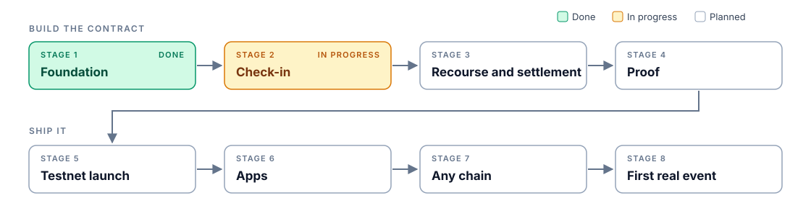

# Bail roadmap

What is being built, in order. Each stage builds on the one before it. The design behind every item is in [ARCHITECTURE.md](ARCHITECTURE.md).

| Stage | What it delivers | Status |
|---|---|---|
| 1. Foundation | Events and deposit RSVPs | Done |
| 2. Check-in | Live codes that prove who was there | Done |
| 3. Recourse and settlement | Fair outcomes, payouts and reliability records | In progress |
| 4. Proof | Tests that back every promise, including the Kickback comparison | Planned |
| 5. Testnet launch | A locked, verifiable contract on NEAR testnet | Planned |
| 6. Apps | SDK, relayer, host console and web app | Planned |
| 7. Any chain | Deposits from any chain through NEAR Intents | Planned |
| 8. First real event | A live event with published results | Planned |

## 1. Foundation (done)

- [x] Event creation with prepaid seat storage, so attendees never need NEAR
- [x] RSVPs by deposit through `ft_transfer_call` with an RSVP note, the same path 1Click uses
- [x] Only transfers that can't be returned any other way are bounced; late, full and duplicate deposits are kept as owed to the attendee

## 2. Check-in (done)

- [x] Whole event schedule fixed at creation: cancel cutoff, check-in window, code slots, reveal and dispute periods, and a required arbiter
- [x] Free cancellation before the cutoff, and organizer cancellation only before check-in
- [x] Live code slots that open one at a time, each committed onchain as it opens
- [x] Catching codes with proofs bound to each attendee's ticket key, with typos fixable inside the window
- [x] Flags for slots where no code was shown
- [x] Reveals that anyone can make, and a qualification rule where a missing slot can only lower the bar

## 3. Recourse and settlement (in progress)

- [x] Vouching for attendees whose phone died
- [x] A required arbiter, never the organizer, who can void an event and can only refund
- [ ] Tally that anyone can run, in pages, fixing the pool, bonus and fee before any money moves
- [ ] Reliability records for every payout address
- [ ] Payouts pushed in pages or claimed per ticket, with failed transfers kept as owed
- [ ] Payouts into NEAR Intents balances on mainnet

## 4. Proof

- [ ] Property tests for conservation, principal protection, no erasure and refund bias
- [ ] Kickback's own contract in a Foundry test, with its organizer taking every deposit, and the same attack failing against Bail
- [ ] A whole event lifecycle on the compiled contract in a local NEAR sandbox
- [ ] Reproducible build and continuous integration

## 5. Testnet launch

- [ ] Contract deployed to `v1.dontbail.testnet` and locked, with no access keys left
- [ ] Verify script checking that the onchain code hash matches the reproducible build

## 6. Apps

- [ ] TypeScript SDK, byte-identical to the contract
- [ ] Relayer and keeper, so attendees pay no NEAR gas and events settle themselves
- [ ] Testnet onboarding with a faucet and meta transactions, starting from a fresh browser with no NEAR
- [ ] Host console to create events, run live codes, reveal them and report results
- [ ] Web app: event page, RSVP, live check-in, results and organizer view

## 7. Any chain

- [ ] Deposits from any chain and asset through 1Click, with the RSVP note delivered onchain
- [ ] Live quotes on testnet, and real cross-chain RSVPs on mainnet

## 8. First real event

- [ ] Dry run with a small group
- [ ] A live online event with real attendees on testnet
- [ ] Published results: RSVPs, show-up rate, payouts and transaction links
- [ ] README with step-by-step trial instructions, and CLAIMS.md linking every claim to its proof
